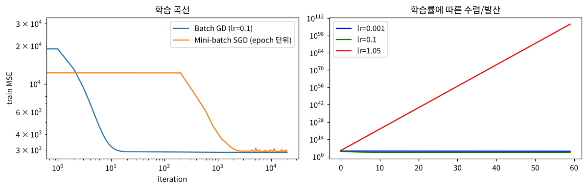
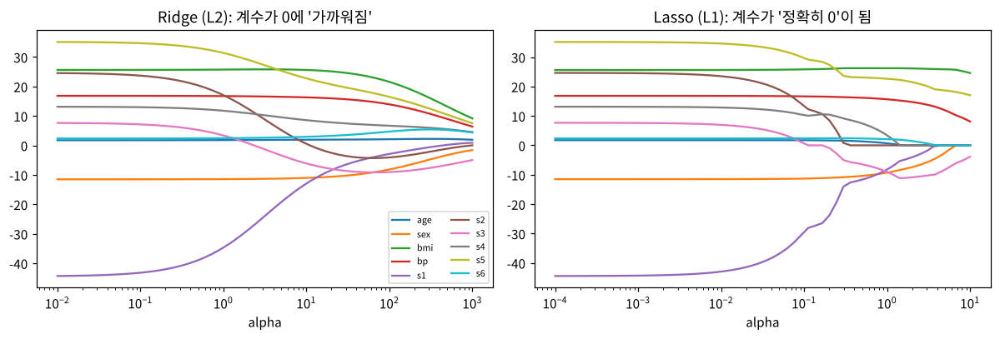

# 지도학습 ① 회귀 (Regression)

연속적인 수치를 예측 (집값, 매출, 온도 등)

## 1. 선형 회귀 (Linear Regression)
ŷ = w₀ + w₁x₁ + … + wₙxₙ = **wᵀx**

### 손실 함수: 평균제곱오차 (MSE)
L(w) = (1/n) Σ (yᵢ − ŷᵢ)²

### 풀이 방법
1. **정규방정식(Normal Equation)**: w = (XᵀX)⁻¹Xᵀy  → 한 번에 해를 구함, 특성 수가 많으면 느림 (O(n³))
2. **경사하강법(Gradient Descent)**: 손실의 기울기 반대 방향으로 조금씩 이동

```
w ← w − η · ∇L(w)       (η: 학습률)
∇L(w) = (2/n) Xᵀ(Xw − y)
```

| 종류 | 한 번 업데이트에 쓰는 데이터 | 특징 |
|---|---|---|
| Batch GD | 전체 | 안정적, 느림 |
| SGD | 1개 | 빠름, 요동 큼 |
| Mini-batch GD | 32~512개 | 실무 표준 (딥러닝 포함) |

학습률이 너무 크면 발산, 너무 작으면 매우 느림.

### 선형 회귀의 가정
선형성, 오차의 독립성, 등분산성, 오차의 정규성, 다중공선성 없음

## 2. 다항 회귀 (Polynomial Regression)
특성을 x, x², x³ … 로 확장 후 선형 회귀 → 비선형 관계 표현. 차수가 높을수록 과적합 위험.

## 3. 규제 회귀 (Regularized Regression)
손실에 가중치 크기 패널티를 추가해 과적합 방지

| 모델 | 패널티 | 효과 |
|---|---|---|
| Ridge (L2) | α Σ wᵢ² | 가중치를 고르게 작게, 다중공선성에 강함 |
| Lasso (L1) | α Σ |wᵢ| | 일부 가중치를 정확히 0 → **특성 선택** |
| ElasticNet | L1 + L2 | 둘의 절충 |

- α↑ → 규제↑ → 편향↑ 분산↓
- 규제 사용 시 **스케일링 필수**

## 4. 기타 회귀 모델
- KNN 회귀, 결정트리 회귀, 랜덤포레스트/GBM 회귀, SVR
- Huber 회귀: 이상치에 강건한 손실

## 5. 회귀 평가 지표
| 지표 | 수식 | 해석 |
|---|---|---|
| MAE | mean(|y−ŷ|) | 직관적, 이상치에 덜 민감 |
| MSE | mean((y−ŷ)²) | 큰 오차에 큰 벌점 |
| RMSE | √MSE | 타깃과 단위 동일 |
| R² | 1 − SSE/SST | 1에 가까울수록 좋음, 0이면 평균 예측 수준 |
| MAPE | mean(|y−ŷ|/|y|) | 비율 오차, y≈0이면 불안정 |

## 6. 코드
```python
from sklearn.linear_model import LinearRegression, Ridge, Lasso
from sklearn.model_selection import train_test_split
from sklearn.metrics import mean_squared_error, r2_score

X_tr, X_te, y_tr, y_te = train_test_split(X, y, test_size=0.2, random_state=42)
for m in [LinearRegression(), Ridge(alpha=1.0), Lasso(alpha=0.1)]:
    m.fit(X_tr, y_tr)
    p = m.predict(X_te)
    print(type(m).__name__, mean_squared_error(y_te, p) ** 0.5, r2_score(y_te, p))
```

### NumPy로 경사하강법 직접 구현
```python
import numpy as np
X_b = np.c_[np.ones(len(X)), X]   # 편향 항
w = np.zeros(X_b.shape[1]); lr = 0.01
for epoch in range(1000):
    grad = 2 / len(X_b) * X_b.T @ (X_b @ w - y)
    w -= lr * grad
```

## ✅ 체크리스트
- [ ] MSE의 기울기를 유도하고 경사하강법을 직접 구현할 수 있다
- [ ] Ridge와 Lasso의 차이(특히 Lasso가 0을 만드는 이유)를 설명할 수 있다
- [ ] RMSE, MAE, R²를 상황에 맞게 고를 수 있다

---

## 🧪 실습

**코드** · [`ml03_regression_gradient_descent.py`](code/ml03_regression_gradient_descent.py)  
**실행 로그** · [`ml03_regression_gradient_descent.txt`](code/outputs/ml03_regression_gradient_descent.txt)

<p>
  
  
</p>

### 📝 실습 후 정리

- 정규방정식·경사하강법·sklearn의 계수가 소수점까지 일치 (diabetes 데이터, RMSE 53.85, R² 0.453).
- s1·s2 특성의 다중공선성 때문에 GD 수렴이 매우 느렸음 (500회로는 계수 차이 16, 20000회에서 일치) → 스케일링/규제가 수렴에도 영향.
- 학습률 1.05는 발산, 0.001은 너무 느림. Lasso(α=1)는 s2 계수를 정확히 0으로 만들어 특성 선택 효과 확인.
