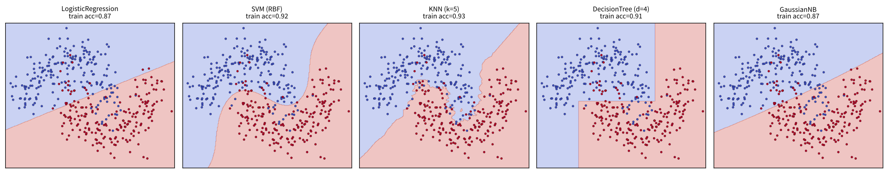
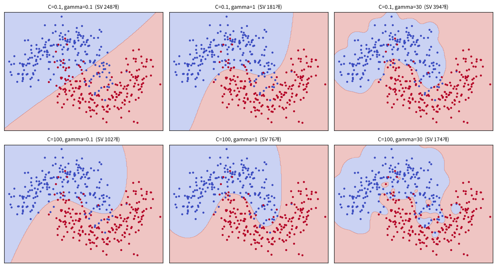

# 지도학습 ② 분류 (Classification)

이산적인 클래스를 예측 (스팸/정상, 질병 유무, 이미지 카테고리)

## 1. 로지스틱 회귀 (Logistic Regression)
이름은 회귀지만 **분류 모델**.
- z = wᵀx, p = σ(z) = 1 / (1 + e⁻ᶻ)  → 0~1 확률
- 손실: **이진 교차엔트로피 (Log loss)**
  L = −[y log p + (1−y) log(1−p)]
- 다중 클래스: **Softmax** + 교차엔트로피
- 장점: 빠르고 해석 가능(계수 = 로그 오즈 변화), 확률 출력
- 결정 경계는 선형

## 2. K-최근접 이웃 (KNN)
- 가장 가까운 K개 이웃의 다수결
- 학습이 없음(lazy), 예측이 느림
- K 작음 → 과적합, K 큼 → 과소적합
- 스케일링 필수, 고차원에서 성능 저하(차원의 저주)

## 3. 서포트 벡터 머신 (SVM)
- 클래스 사이 **마진(margin)을 최대화**하는 경계
- 서포트 벡터: 경계에 가장 가까운 샘플
- **C**: 오분류 허용 정도 (C↑ → 마진 좁고 과적합 경향)
- **커널 트릭**: 고차원으로 매핑한 효과를 계산량 없이 → RBF, 다항 커널
  - RBF의 **γ**: 클수록 경계가 구불구불 (과적합)
- 중소규모 데이터에 강함, 대규모에선 느림

## 4. 결정 트리 (Decision Tree)
- 질문(분할)을 반복해 데이터를 나눔
- 분할 기준: **지니 불순도** 1−Σpᵢ², **엔트로피** −Σpᵢ log pᵢ → 정보 이득 최대화
- 장점: 해석 쉬움, 스케일링 불필요, 비선형 처리
- 단점: 과적합 쉬움 → `max_depth`, `min_samples_leaf`, 가지치기
- 앙상블(랜덤포레스트, 부스팅)의 기반

## 5. 나이브 베이즈 (Naive Bayes)
- 베이즈 정리: P(y|x) ∝ P(x|y)P(y)
- 특성들이 **조건부 독립**이라는 "순진한" 가정
- 텍스트 분류(스팸)에 빠르고 의외로 강함 (MultinomialNB)

## 6. 모델 비교 요약
| 모델 | 해석성 | 스케일링 | 비선형 | 대용량 | 대표 용도 |
|---|---|---|---|---|---|
| 로지스틱 회귀 | 높음 | 필요 | ✗ | ✓ | 베이스라인, 확률 |
| KNN | 중 | 필수 | ✓ | ✗ | 소규모, 추천 |
| SVM | 낮음 | 필수 | ✓(커널) | ✗ | 중소규모 고차원 |
| 결정트리 | 매우 높음 | 불필요 | ✓ | ✓ | 설명이 중요할 때 |
| 나이브 베이즈 | 중 | 불필요 | ✗ | ✓ | 텍스트 |
| 앙상블(GBM) | 낮음 | 불필요 | ✓ | ✓ | **정형 데이터 최강** |

## 7. 다중 클래스 전략
- OvR(One-vs-Rest), OvO(One-vs-One), Softmax(다항)
- 다중 레이블(multi-label): 샘플이 여러 클래스를 동시에 가짐 → 클래스마다 시그모이드

## 8. 코드
```python
from sklearn.linear_model import LogisticRegression
from sklearn.svm import SVC
from sklearn.tree import DecisionTreeClassifier
from sklearn.neighbors import KNeighborsClassifier
from sklearn.model_selection import cross_val_score
from sklearn.pipeline import make_pipeline
from sklearn.preprocessing import StandardScaler

models = {
  "logreg": make_pipeline(StandardScaler(), LogisticRegression(max_iter=1000)),
  "svm":    make_pipeline(StandardScaler(), SVC(C=1, kernel="rbf")),
  "knn":    make_pipeline(StandardScaler(), KNeighborsClassifier(5)),
  "tree":   DecisionTreeClassifier(max_depth=5),
}
for name, m in models.items():
    print(name, cross_val_score(m, X, y, cv=5, scoring="f1_macro").mean())
```

---

## 🧪 실습

**코드** · [`ml04_classification_models.py`](code/ml04_classification_models.py)  
**실행 로그** · [`ml04_classification_models.txt`](code/outputs/ml04_classification_models.txt)

<p>
  
  
</p>

### 📝 실습 후 정리

- 유방암 데이터 5-Fold: 로지스틱 회귀 acc 0.979 / SVM 0.977 / KNN 0.965 / 트리 0.926 / NB 0.939 → 단순 선형 모델도 강력한 베이스라인.
- 스케일링 효과: KNN 0.932→0.965, SVM 0.921→0.977. 거리·마진 기반 모델은 스케일링 필수.
- 루트 노드 지니 불순도를 손으로 계산(0.4675)한 값이 sklearn과 정확히 같았고, 깊이 2 트리 규칙(worst radius ≤ 16.8 …)으로 해석 가능.
