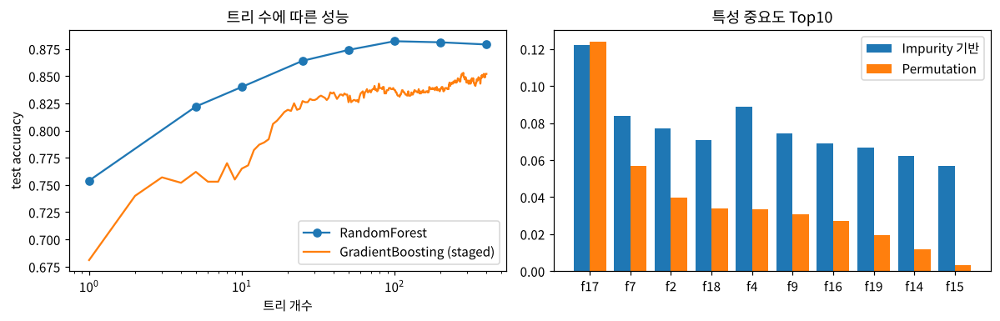

# 앙상블 학습 (Ensemble Learning)

> 여러 약한 모델을 합치면 하나의 강한 모델보다 낫다. **정형(표) 데이터에서 사실상 표준.**

## 1. 왜 앙상블이 잘 되나?
서로 다른 실수를 하는 모델들을 평균하면 오차가 상쇄된다 → **분산 감소**(배깅) 또는 **편향 감소**(부스팅)

## 2. 보팅 (Voting)
- 하드 보팅: 다수결
- 소프트 보팅: 확률 평균 (보통 더 좋음)

## 3. 배깅 (Bagging = Bootstrap Aggregating)
- 원본에서 **복원추출**(bootstrap)한 데이터로 여러 모델을 **병렬** 학습 → 평균/다수결
- 주로 분산이 큰 모델(깊은 트리)에 효과적
- OOB(Out-of-Bag) 샘플로 별도 검증 가능

### 랜덤 포레스트 (Random Forest)
- 배깅 + 각 분할에서 **특성도 무작위 일부만** 고려 → 트리 간 상관↓
- 주요 하이퍼파라미터: `n_estimators`, `max_depth`, `max_features`, `min_samples_leaf`
- 튜닝 없이도 강한 베이스라인, 과적합에 비교적 강함

## 4. 부스팅 (Boosting)
- 모델을 **순차적**으로 학습, 이전 모델이 틀린 부분을 다음 모델이 보완
- 편향을 줄임, 대신 과적합 주의

### AdaBoost
틀린 샘플의 가중치를 높여 다음 모델이 집중하게 함

### Gradient Boosting (GBM)
- 이전까지의 예측의 **잔차(손실의 음의 기울기)**를 다음 트리가 학습
- F_m(x) = F_{m−1}(x) + η · h_m(x)
- 학습률 η 작게 + 트리 수 많게 = 보통 더 좋음

### 현대 GBM 라이브러리
| 라이브러리 | 특징 |
|---|---|
| **XGBoost** | 2차 미분 활용, 정규화 항, 결측치 자동 처리 |
| **LightGBM** | 히스토그램 기반 + Leaf-wise 성장 → 매우 빠름, 대용량에 강함 |
| **CatBoost** | 범주형 변수 자동 처리(Ordered target statistics), 기본값 성능 우수 |

핵심 하이퍼파라미터: `learning_rate`, `n_estimators`, `max_depth`/`num_leaves`, `subsample`, `colsample_bytree`, `reg_lambda`, `min_child_samples` + **early stopping**

## 5. 스태킹 (Stacking)
- 여러 기본 모델의 예측값을 입력으로 **메타 모델**이 최종 예측
- 누수 방지를 위해 OOF(out-of-fold) 예측 사용
- Kaggle 상위권 단골 기법

## 6. 배깅 vs 부스팅
| | 배깅 | 부스팅 |
|---|---|---|
| 학습 방식 | 병렬 | 순차 |
| 주로 줄이는 것 | 분산 | 편향 |
| 과적합 위험 | 낮음 | 상대적으로 높음 |
| 대표 | Random Forest | XGBoost, LightGBM, CatBoost |

## 7. 코드
```python
import lightgbm as lgb
from sklearn.model_selection import train_test_split
X_tr, X_va, y_tr, y_va = train_test_split(X, y, test_size=0.2, stratify=y, random_state=42)
model = lgb.LGBMClassifier(n_estimators=5000, learning_rate=0.03, num_leaves=31,
                           subsample=0.8, subsample_freq=1, colsample_bytree=0.8)
model.fit(X_tr, y_tr, eval_set=[(X_va, y_va)],
          callbacks=[lgb.early_stopping(100), lgb.log_evaluation(200)])
```

## 8. 해석: Feature Importance & SHAP
- 트리 기본 중요도(split/gain)는 편향될 수 있음 → **Permutation importance**, **SHAP** 권장
- SHAP: 각 특성이 예측을 얼마나 올리고 내렸는지 게임이론(Shapley value) 기반으로 분해

---

## 🧪 실습

**코드** · [`ml05_ensemble.py`](code/ml05_ensemble.py)  
**실행 로그** · [`ml05_ensemble.txt`](code/outputs/ml05_ensemble.txt)

<p>
  
</p>

### 📝 실습 후 정리

- 단일 트리 test 0.781 → 배깅 0.885, 랜덤포레스트 0.876, HistGB 0.872로 크게 향상. 트리는 train 1.0으로 과적합.
- RandomForest의 OOB 점수 0.880이 실제 test 점수와 거의 같음 → 검증셋 없이도 성능 추정 가능.
- Stacking(0.884)이 개별 모델(RF 0.876, HGB 0.878)보다 약간 좋음.
- Impurity 중요도와 Permutation 중요도의 순위가 다를 수 있음을 확인.
