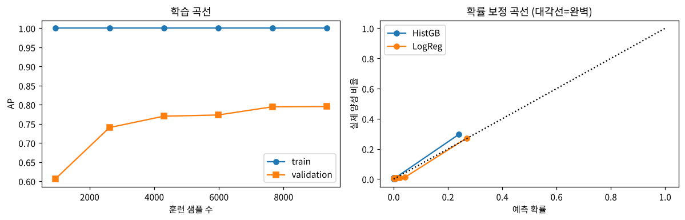
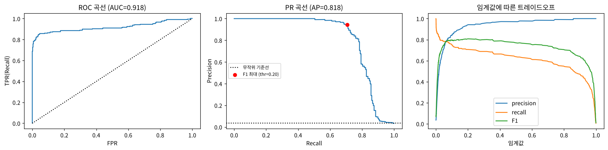

# 모델 평가 & 검증 & 튜닝

## 1. 교차 검증 (Cross Validation)
| 방법 | 설명 | 언제 |
|---|---|---|
| Hold-out | train/val 1회 분할 | 데이터 많을 때 |
| K-Fold | K등분, 돌아가며 검증 | 기본 |
| Stratified K-Fold | 클래스 비율 유지 | **분류 기본값** |
| Group K-Fold | 같은 그룹(사용자 등)이 train/val에 섞이지 않게 | 그룹 누수 방지 |
| TimeSeriesSplit | 과거로 학습 → 미래로 검증 | **시계열** |
| LOOCV | 1개씩 검증 | 데이터 매우 적을 때 |

## 2. 분류 지표

### 혼동 행렬 (Confusion Matrix)
|  | 예측 Positive | 예측 Negative |
|---|---|---|
| **실제 Positive** | TP | FN (2종 오류, 놓침) |
| **실제 Negative** | FP (1종 오류, 오경보) | TN |

| 지표 | 수식 | 의미 / 중요한 상황 |
|---|---|---|
| Accuracy | (TP+TN)/전체 | 클래스 균형일 때만 의미 |
| Precision | TP/(TP+FP) | 양성이라 한 것 중 진짜 비율 — **FP가 비쌀 때** (스팸 필터) |
| Recall (민감도) | TP/(TP+FN) | 실제 양성 중 찾은 비율 — **FN이 비쌀 때** (암 진단, 사기 탐지) |
| F1 | 2PR/(P+R) | 정밀도-재현율 조화평균 |
| ROC-AUC | TPR vs FPR 곡선 아래 면적 | 임계값 무관 순위 성능 |
| PR-AUC | Precision-Recall 곡선 면적 | **불균형 데이터**에서 ROC-AUC보다 정직 |
| Log loss | 교차엔트로피 | 확률 품질 |

- 정밀도와 재현율은 **임계값(threshold)**으로 트레이드오프
- 다중 클래스: macro(클래스 평균), weighted, micro 평균

## 3. 회귀 지표
MAE, MSE, RMSE, R², MAPE → [03_지도학습_회귀.md](03_지도학습_회귀.md) 참고

## 4. 하이퍼파라미터 튜닝
| 방법 | 특징 |
|---|---|
| Grid Search | 모든 조합, 비쌈 |
| Random Search | 무작위 샘플, 고차원에서 Grid보다 효율적 |
| Bayesian Optimization | 이전 결과로 다음 후보를 똑똑하게 선택 (**Optuna**) |
| Successive Halving / Hyperband | 나쁜 후보를 일찍 중단 |

```python
import optuna
from sklearn.model_selection import cross_val_score
import lightgbm as lgb

def objective(trial):
    params = dict(
        learning_rate=trial.suggest_float("lr", 1e-3, 0.3, log=True),
        num_leaves=trial.suggest_int("num_leaves", 15, 255),
        min_child_samples=trial.suggest_int("mcs", 5, 100),
        n_estimators=500, verbose=-1)
    return cross_val_score(lgb.LGBMClassifier(**params), X, y, cv=5, scoring="roc_auc").mean()

study = optuna.create_study(direction="maximize")
study.optimize(objective, n_trials=50)
```

## 5. 학습 곡선 & 검증 곡선
- **학습 곡선**(데이터 양 vs 점수): 두 곡선이 모두 낮게 수렴 → 과소적합 / 큰 격차 → 과적합(데이터 추가가 도움)
- **검증 곡선**(하이퍼파라미터 vs 점수): 최적 복잡도 찾기

## 6. 확률 보정 (Calibration)
예측 확률 0.8이 실제로 80% 맞는가? → Reliability diagram, `CalibratedClassifierCV` (Platt, Isotonic)

## 7. 통계적 비교
작은 점수 차이는 우연일 수 있음 → 여러 시드/폴드의 평균±표준편차로 비교

## ✅ 체크리스트
- [ ] Precision과 Recall 중 어느 것이 중요한지 문제별로 판단할 수 있다
- [ ] 불균형 데이터에서 Accuracy가 위험한 이유를 안다
- [ ] 시계열에 일반 K-Fold를 쓰면 안 되는 이유를 안다
- [ ] Optuna로 튜닝을 돌릴 수 있다

---

## 🧪 실습

**코드** · [`ml07_evaluation_tuning.py`](code/ml07_evaluation_tuning.py)  
**실행 로그** · [`ml07_evaluation_tuning.txt`](code/outputs/ml07_evaluation_tuning.txt)

<p>
  
  
</p>

### 📝 실습 후 정리

- 양성 3.5% 데이터에서 '전부 음성' 모델이 accuracy 0.965 / F1 0 → 불균형 데이터에서 정확도는 의미 없음.
- 임계값 0.5→0.2로 바꾸니 F1 0.767→0.808. 재현율 90%를 보장하려면 precision이 0.08까지 떨어짐 → 임계값은 비즈니스 비용으로 정해야 함.
- class_weight=balanced는 recall 0.48→0.82로 올리지만 F1은 하락. 같은 18회 예산에서 Random Search(AP 0.728)가 Grid(0.722)보다 약간 좋았음.
