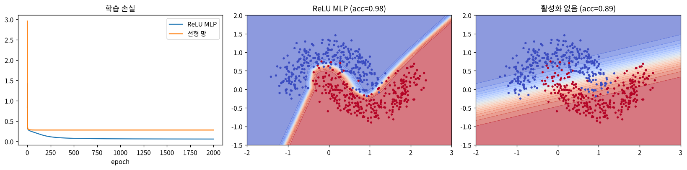

# 신경망 기초 (Neural Network Fundamentals)

## 1. 퍼셉트론 → 다층 퍼셉트론(MLP)
- 뉴런: y = f(wᵀx + b)   (f: 활성화 함수)
- 단층 퍼셉트론은 선형 분리만 가능 (XOR 불가)
- **은닉층 + 비선형 활성화** → 임의의 연속 함수 근사 가능 (보편 근사 정리)
- "딥" = 은닉층이 여러 개 → 계층적 특징 학습 (저수준 → 고수준)

```
입력층 ──▶ 은닉층1 ──▶ 은닉층2 ──▶ 출력층
  x      h1=f(W1x+b1)  h2=f(W2h1+b2)  ŷ=g(W3h2+b3)
```

## 2. 활성화 함수
| 함수 | 식 | 특징 |
|---|---|---|
| Sigmoid | 1/(1+e⁻ˣ) | 0~1, 기울기 소실, 이진 출력층 |
| Tanh | (eˣ−e⁻ˣ)/(eˣ+e⁻ˣ) | −1~1, 0 중심 |
| **ReLU** | max(0,x) | 계산 빠름, 기울기 소실 완화, Dying ReLU |
| Leaky ReLU | max(αx, x) | 음수 영역 작은 기울기 |
| **GELU** | x·Φ(x) | Transformer 표준 |
| SiLU/Swish | x·σ(x) | 최근 CNN·LLM (SwiGLU) |
| Softmax | eᶻⁱ/Σeᶻʲ | 다중 클래스 출력층 |

비선형 활성화가 없으면 층을 아무리 쌓아도 하나의 선형 변환과 같다.

## 3. 출력층 & 손실 함수 조합
| 문제 | 출력층 | 손실 |
|---|---|---|
| 회귀 | 선형 | MSE / MAE / Huber |
| 이진 분류 | Sigmoid | Binary Cross-Entropy |
| 다중 분류 | Softmax | Cross-Entropy |
| 다중 레이블 | 클래스별 Sigmoid | BCE |

PyTorch의 `nn.CrossEntropyLoss`는 **로짓(softmax 전 값)**을 받는다 (내부에서 log-softmax).

## 4. 순전파 & 역전파 (Backpropagation)
- **순전파**: 입력 → 출력 → 손실 계산
- **역전파**: **연쇄 법칙(chain rule)**으로 손실의 각 파라미터에 대한 기울기를 출력층부터 거꾸로 계산
- 계산 그래프 + 자동 미분(autograd)이 이를 자동으로 처리

예) L = (ŷ − y)², ŷ = w·x
∂L/∂w = ∂L/∂ŷ · ∂ŷ/∂w = 2(ŷ − y) · x

## 5. 기울기 소실 / 폭발
- 깊은 망에서 기울기가 곱해지며 0으로 사라지거나 무한히 커짐
- 해결: ReLU 계열, 적절한 초기화(He/Xavier), 정규화 층, **잔차 연결(residual)**, gradient clipping, LSTM 게이트

## 6. PyTorch 최소 예제
```python
import torch, torch.nn as nn

model = nn.Sequential(
    nn.Linear(784, 256), nn.ReLU(),
    nn.Linear(256, 128), nn.ReLU(),
    nn.Linear(128, 10))
loss_fn = nn.CrossEntropyLoss()
opt = torch.optim.AdamW(model.parameters(), lr=1e-3)

for x, y in train_loader:
    logits = model(x.view(x.size(0), -1))
    loss = loss_fn(logits, y)
    opt.zero_grad()
    loss.backward()      # 역전파
    opt.step()           # 파라미터 업데이트
```

## 7. 텐서와 차원 감각
- 이미지 배치: `(B, C, H, W)`
- 시퀀스 배치: `(B, T, D)` — 배치, 시간(토큰), 임베딩 차원
- 차원(shape) 추적 습관이 디버깅의 절반

---

## 🧪 실습

**코드** · [`dl01_mlp_backprop_numpy.py`](code/dl01_mlp_backprop_numpy.py)  
**실행 로그** · [`dl01_mlp_backprop_numpy.txt`](code/outputs/dl01_mlp_backprop_numpy.txt)

<p>
  
</p>

### 📝 실습 후 정리

- 직접 유도한 역전파 기울기와 수치 미분의 최대 상대오차 2.85e-08 → 구현이 맞음을 검증.
- 초승달 데이터에서 ReLU MLP 정확도 0.982, 활성화 함수를 뺀 망은 0.887 (사실상 선형 분류기).
- 은닉 뉴런 2개는 0.895로 부족하고 4개 이상이면 충분 → 표현력과 모델 크기의 관계.
