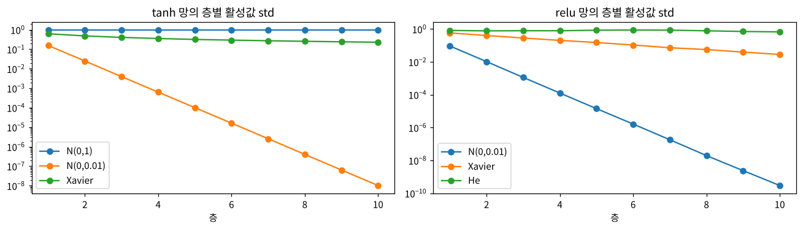
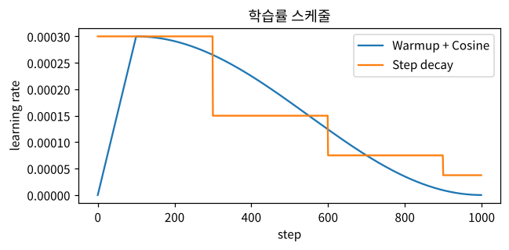
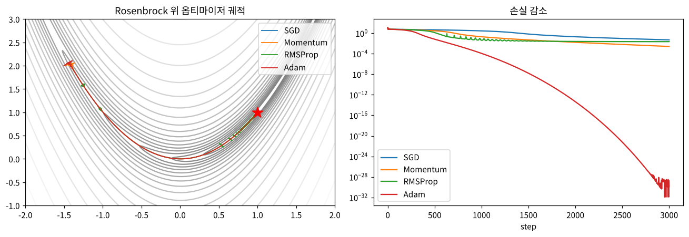

# 최적화(Optimization) & 정규화(Regularization)

## 1. 옵티마이저
| 옵티마이저 | 아이디어 |
|---|---|
| SGD | w ← w − η∇L |
| Momentum | 이전 이동 방향을 관성처럼 누적 → 진동 감소, 빠른 수렴 |
| Nesterov | 미리 이동한 위치에서 기울기 계산 |
| AdaGrad | 많이 업데이트된 파라미터는 학습률↓ (희소 특성에 좋음, 학습률이 계속 줄어듦) |
| RMSProp | 기울기 제곱의 지수이동평균으로 AdaGrad 보완 |
| **Adam** | Momentum + RMSProp + 편향 보정 |
| **AdamW** | Adam + **분리된 weight decay** → Transformer/LLM 표준 |

- 실무 기본값: **AdamW, lr 1e-3(작은 모델) ~ 1e-4/3e-4(Transformer), weight_decay 0.01~0.1**
- CNN 이미지 분류에선 SGD+Momentum이 일반화가 더 좋은 경우도 있음

## 2. 학습률 스케줄
- Step decay, Exponential decay
- **Warmup + Cosine decay** (Transformer 표준)
- OneCycle
- ReduceLROnPlateau (검증 손실 정체 시 감소)
- 학습률이 가장 중요한 하이퍼파라미터 → **LR range test**로 범위 탐색

## 3. 가중치 초기화
- 모두 0 초기화 ❌ (대칭성 문제: 모든 뉴런이 똑같이 학습)
- **Xavier/Glorot**: tanh/sigmoid용, Var = 2/(n_in+n_out)
- **He/Kaiming**: ReLU용, Var = 2/n_in

## 4. 정규화 층 (Normalization)
| 방법 | 정규화 축 | 사용처 |
|---|---|---|
| **BatchNorm** | 배치 방향 | CNN, 큰 배치. 학습/추론 동작이 다름(`model.eval()` 필수) |
| **LayerNorm** | 특성 방향(샘플별) | Transformer, RNN |
| RMSNorm | LayerNorm에서 평균 빼기 생략 | 최근 LLM |
| GroupNorm | 채널 그룹 | 작은 배치 CNN |

효과: 학습 안정화, 더 큰 학습률 허용, 빠른 수렴

## 5. 과적합 방지 (Regularization)
- **Weight decay (L2)**
- **Dropout**: 학습 시 뉴런을 확률 p로 끔 → 앙상블 효과. 추론 시엔 끔
- **Early stopping**: 검증 손실이 개선 안 되면 중단
- **데이터 증강**: 이미지 뒤집기/자르기/색변환, Mixup, CutMix, 텍스트 역번역
- **Label smoothing**: 정답 확률을 1 대신 0.9 등으로 → 과신 방지
- Stochastic depth, gradient clipping

## 6. 배치 크기
- 크면: 빠른 연산(GPU 활용), 안정적 기울기, 메모리↑, 일반화가 약간 나빠질 수 있음 → 학습률도 함께 키움(선형 스케일링 규칙)
- 작으면: 노이즈가 규제 효과, 느림
- 메모리 부족 시 **gradient accumulation**으로 큰 배치 흉내

## 7. 손실 지형 (Loss landscape)
- 고차원에선 지역 최솟값보다 **안장점(saddle point)**이 더 큰 문제
- 평평한 최솟값(flat minima)이 일반화에 유리하다는 관점 → SAM 옵티마이저

---

## 🧪 실습

**코드** · [`dl02_optimizers_init_norm.py`](code/dl02_optimizers_init_norm.py)  
**실행 로그** · [`dl02_optimizers_init_norm.txt`](code/outputs/dl02_optimizers_init_norm.txt)

  
  
  

### 📝 실습 후 정리

- Rosenbrock 함수 3000스텝: SGD f=4.9e-2, Momentum 2.6e-3, Adam은 최솟값 (1,1)에 정확히 도달.
- 10층 tanh 망에서 N(0,1) 초기화는 87%가 포화, N(0,0.01)은 신호가 1e-8로 소멸. ReLU+He 초기화만 10층 후에도 std 0.67 유지.
- Inverted dropout은 학습 시 평균을 유지(0.999)하고, BatchNorm/LayerNorm은 정규화 축이 다르다는 걸 숫자로 확인.
