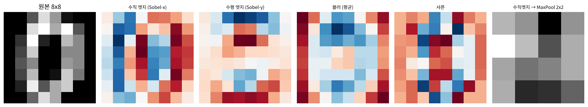

# 합성곱 신경망 (CNN, Convolutional Neural Network)

## 1. 왜 CNN인가?
MLP로 이미지를 처리하면 파라미터가 폭발하고 공간 구조를 무시한다.
CNN의 귀납적 편향(inductive bias):
- **지역 연결**: 가까운 픽셀끼리 관련
- **가중치 공유**: 같은 필터를 이미지 전체에 적용 → 위치 불변 특징 탐지
- **계층 구조**: 엣지 → 질감 → 부분 → 물체

## 2. 합성곱 층 (Convolution)
- 필터(커널)가 입력 위를 슬라이딩하며 내적 → **특징 맵(feature map)**
- 하이퍼파라미터: 커널 크기 K, 스트라이드 S, 패딩 P, 출력 채널 수
- **출력 크기** = ⌊(N + 2P − K) / S⌋ + 1
- 파라미터 수 = K × K × C_in × C_out (+ C_out 편향)
- **수용 영역(receptive field)**: 층이 깊어질수록 넓어짐

## 3. 풀링 (Pooling)
- Max pooling / Average pooling: 공간 크기 축소, 약간의 위치 불변성
- Global Average Pooling: 마지막에 FC 대신 사용 → 파라미터 감소

## 4. 대표 아키텍처 흐름
| 모델 | 연도 | 핵심 기여 |
|---|---|---|
| LeNet-5 | 1998 | 최초의 실용 CNN (손글씨) |
| AlexNet | 2012 | ReLU, Dropout, GPU — 딥러닝 붐 시작 |
| VGG | 2014 | 3×3 필터를 깊게 쌓기 |
| GoogLeNet/Inception | 2014 | 여러 크기 필터 병렬, 1×1 conv로 차원 축소 |
| **ResNet** | 2015 | **잔차 연결** y = F(x) + x → 100층 이상 학습 가능 |
| DenseNet | 2017 | 모든 이전 층 연결 |
| MobileNet | 2017~ | Depthwise separable conv → 경량화 |
| EfficientNet | 2019 | 깊이·너비·해상도 동시 스케일링 |
| ConvNeXt | 2022 | Transformer 설계를 CNN에 반영 |

ResNet 잔차 블록:
```
x ──▶ Conv-BN-ReLU-Conv-BN ──▶ (+) ──▶ ReLU
 └──────────────────────────────┘ (skip connection)
```

## 5. 전이 학습 (Transfer Learning)
대규모 데이터(ImageNet)로 사전학습된 모델을 가져와 내 문제에 맞춤
1. **특징 추출**: 백본 고정, 마지막 분류기만 학습 (데이터 적을 때)
2. **파인튜닝**: 일부/전체 층을 작은 학습률로 재학습

```python
import torch.nn as nn
from torchvision import models
m = models.resnet50(weights="IMAGENET1K_V2")
for p in m.parameters(): p.requires_grad = False   # 백본 고정
m.fc = nn.Linear(m.fc.in_features, num_classes)    # 새 분류기
```

## 6. 컴퓨터 비전 주요 태스크
| 태스크 | 출력 | 대표 모델 |
|---|---|---|
| 분류 | 클래스 | ResNet, EfficientNet, ViT |
| 객체 탐지 | 박스 + 클래스 | Faster R-CNN(2-stage), YOLO 계열(1-stage), DETR |
| 의미론적 분할 | 픽셀별 클래스 | U-Net, DeepLab |
| 인스턴스 분할 | 객체별 마스크 | Mask R-CNN, SAM |
| 이미지-텍스트 | 임베딩 정렬 | CLIP |

탐지 관련 용어: IoU, NMS(비최대 억제), Anchor, mAP

## 7. CNN vs Vision Transformer
- CNN: 귀납적 편향 강함 → 적은 데이터에 유리
- ViT: 이미지를 패치로 나눠 Transformer 적용 → 대규모 데이터에서 우수
- 최근엔 둘을 혼합한 구조도 많음 → [05_Transformer.md](05_Transformer.md)

## ✅ 체크리스트
- [ ] 합성곱 출력 크기와 파라미터 수를 계산할 수 있다
- [ ] 잔차 연결이 깊은 망 학습을 가능하게 하는 이유를 안다
- [ ] 사전학습 모델로 전이학습 코드를 작성할 수 있다
- [ ] 분류/탐지/분할의 차이를 안다

---

## 🧪 실습

**코드** · [`dl03_cnn_transfer_learning_torch.py`](code/dl03_cnn_transfer_learning_torch.py) · [`dl03_convolution_numpy.py`](code/dl03_convolution_numpy.py)  
**실행 로그** · [`dl03_convolution_numpy.txt`](code/outputs/dl03_convolution_numpy.txt)

<p>
  
</p>

### 📝 실습 후 정리

- conv 출력 크기 공식 (N+2P−K)/S+1을 4가지 설정에서 직접 구현 결과와 대조해 모두 일치.
- 224×224×3 입력에 FC층은 1.5억 개, 3×3 conv 64채널은 1,792개 파라미터 → 가중치 공유의 위력.
- 이미지를 1픽셀 옮기면 원본 픽셀 분류기는 0.961→0.463으로 붕괴, conv+ReLU+pool 특징은 0.674로 덜 떨어짐 → 풀링의 위치 불변성.
