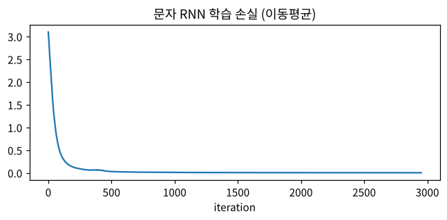
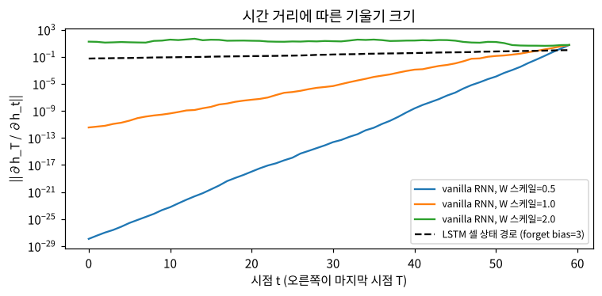

# 순환 신경망 & 시퀀스 모델 (RNN, LSTM, GRU, Seq2Seq)

## 1. 시퀀스 데이터
텍스트, 음성, 시계열, 로그 — **순서**가 의미를 가진다

## 2. 기본 RNN
hₜ = tanh(Wₓ xₜ + Wₕ hₜ₋₁ + b)
- 이전 은닉 상태를 다음 시점으로 전달 → "기억"
- 학습: BPTT (Backpropagation Through Time)
- 문제: 긴 시퀀스에서 **기울기 소실/폭발** → 장기 의존성 학습 어려움

## 3. LSTM (Long Short-Term Memory)
**셀 상태(cell state)** cₜ 라는 별도 "컨베이어 벨트" + 3개의 게이트
| 게이트 | 역할 |
|---|---|
| Forget gate fₜ | 이전 기억 중 무엇을 버릴지 |
| Input gate iₜ | 새 정보 중 무엇을 저장할지 |
| Output gate oₜ | 무엇을 출력(은닉 상태)할지 |

cₜ = fₜ ⊙ cₜ₋₁ + iₜ ⊙ c̃ₜ  → 덧셈 경로 덕분에 기울기가 잘 흐름

## 4. GRU
- LSTM 간소화: Reset gate + Update gate, 셀 상태 없음
- 파라미터 적고 성능 비슷

## 5. 변형 구조
- **양방향 RNN (Bi-RNN)**: 앞·뒤 문맥 모두 사용 (분류/태깅)
- **다층(Stacked) RNN**
- 입출력 형태: many-to-one(감성분석), one-to-many(캡셔닝), many-to-many(번역, 태깅)

## 6. Seq2Seq (인코더-디코더)
```
인코더: "나는 학생이다" → 컨텍스트 벡터 c
디코더: c → "I am a student"
```
- 문제: 긴 문장을 **고정 길이 벡터 하나**에 압축 → 정보 병목
- **Teacher forcing**: 학습 시 이전 정답 토큰을 디코더 입력으로

## 7. 어텐션 (Attention) — Transformer로 가는 다리
- 디코더가 매 시점마다 **인코더의 모든 은닉 상태를 가중합**해서 참조
- 가중치 = 현재 디코더 상태와 각 인코더 상태의 유사도 (Bahdanau, Luong)
- 정렬(alignment)을 자동 학습, 병목 해소
- "RNN 없이 어텐션만으로?" → **Transformer** (2017)

## 8. RNN의 한계 → Transformer
| | RNN | Transformer |
|---|---|---|
| 병렬화 | ✗ (순차 계산) | ✓ |
| 장거리 의존성 | 약함 | 강함 (모든 토큰 직접 연결) |
| 시퀀스 길이 비용 | O(T) 순차 | O(T²) 메모리 |

※ 최근 선형 시간 시퀀스 모델(State Space Model 계열, 예: Mamba)도 연구·활용되고 있음

## 9. 코드
```python
import torch, torch.nn as nn
class TextClassifier(nn.Module):
    def __init__(self, vocab, emb=128, hid=256, n_cls=2):
        super().__init__()
        self.emb = nn.Embedding(vocab, emb, padding_idx=0)
        self.lstm = nn.LSTM(emb, hid, batch_first=True, bidirectional=True)
        self.fc = nn.Linear(hid * 2, n_cls)
    def forward(self, x):                 # x: (B, T)
        out, (h, c) = self.lstm(self.emb(x))
        h = torch.cat([h[-2], h[-1]], dim=1)   # 양방향 마지막 은닉
        return self.fc(h)
```

---

## 🧪 실습

**코드** · [`dl04_rnn_lstm_numpy.py`](code/dl04_rnn_lstm_numpy.py)  
**실행 로그** · [`dl04_rnn_lstm_numpy.txt`](code/outputs/dl04_rnn_lstm_numpy.txt)

<p>
  
  
</p>

### 📝 실습 후 정리

- vanilla RNN의 기울기는 30스텝 전 5.6e-06, 59스텝 전 4.6e-12로 소멸.
- LSTM 셀 경로(forget bias 3)는 59스텝 전에도 3.5e-02 유지.
- BPTT를 직접 구현한 문자 RNN: 손실 3.71 → 0.003. 500회 만에 문장을 생성하지만 텍스트가 작아 사실상 암기(과적합).
- BPTT 기울기에 clipping(±5)을 넣어 기울기 폭발을 막음 → RNN 학습의 기본 장치.
