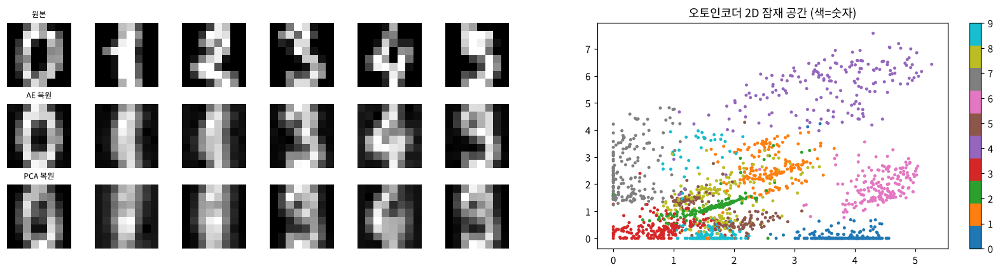
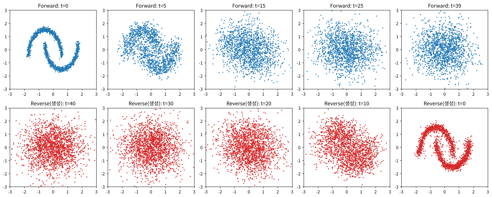

# 생성 모델 (Generative Models)

판별 모델: P(y|x) 학습 → 분류
생성 모델: **P(x)** (데이터 분포 자체) 학습 → 새 샘플 생성

## 1. 오토인코더 (Autoencoder)
```
x → [인코더] → z (잠재 벡터, 저차원) → [디코더] → x̂
손실: 재구성 오차 ||x − x̂||²
```
- 용도: 차원 축소, 노이즈 제거(Denoising AE), 이상 탐지
- 한계: 잠재 공간이 연속적이지 않아 임의의 z로 생성하기 어려움

## 2. VAE (Variational Autoencoder)
- 인코더가 z의 **분포(μ, σ)**를 출력 → 샘플링
- **재매개변수화 트릭**: z = μ + σ·ε, ε~N(0,1) → 역전파 가능
- 손실 = 재구성 손실 + **KL 발산**(잠재 분포를 N(0,1)에 가깝게)
- 장점: 매끄러운 잠재 공간, 보간 가능 / 단점: 결과가 흐릿한 경향
- Stable Diffusion의 **잠재 공간 압축기**로도 사용

## 3. GAN (Generative Adversarial Network)
- **생성자 G**: 노이즈 z → 가짜 이미지
- **판별자 D**: 진짜/가짜 구분
- 미니맥스 게임: min_G max_D E[log D(x)] + E[log(1 − D(G(z)))]
- 장점: 선명한 이미지
- 단점: 학습 불안정, **모드 붕괴(mode collapse)**, 평가 어려움
- 발전: DCGAN, WGAN(Wasserstein 거리), StyleGAN(고해상도 얼굴), CycleGAN(쌍 없는 변환), Pix2Pix

## 4. Diffusion Model (확산 모델) — 현재 이미지/영상 생성의 주류
- **Forward 과정**: 데이터에 가우시안 노이즈를 T단계 점진적으로 추가 → 순수 노이즈
- **Reverse 과정**: 신경망(U-Net 또는 Transformer=DiT)이 **각 단계의 노이즈를 예측**해 제거
- 학습 손실(DDPM): ||ε − ε_θ(x_t, t)||² — 단순하고 안정적
- 샘플링 가속: DDIM, DPM-Solver 등 → 수십 단계로 축소
- **Latent Diffusion (Stable Diffusion)**: 픽셀 대신 VAE 잠재 공간에서 확산 → 연산량 대폭 감소
- **조건부 생성**: 텍스트 임베딩(CLIP/T5)을 cross-attention으로 주입
- **Classifier-Free Guidance (CFG)**: 조건 有/無 예측을 섞어 프롬프트 충실도 조절
- 관련 발전: Flow Matching / Rectified Flow, 영상 생성, ControlNet(포즈·엣지 조건), LoRA로 스타일 학습

## 5. 자기회귀 모델 (Autoregressive)
- P(x) = Π P(xₜ | x<ₜ) — 하나씩 순서대로 생성
- 텍스트 생성 LLM이 대표 (GPT 계열) → [07_LLM_대규모언어모델.md](07_LLM_대규모언어모델.md)
- 이미지도 토큰화하면 자기회귀로 생성 가능

## 6. 비교
| 모델 | 품질 | 다양성 | 학습 안정성 | 샘플링 속도 |
|---|---|---|---|---|
| VAE | 중(흐림) | 높음 | 높음 | 빠름 |
| GAN | 높음 | 낮음(모드붕괴) | 낮음 | 빠름 |
| Diffusion | 매우 높음 | 높음 | 높음 | 느림(개선 중) |
| Autoregressive | 높음 | 높음 | 높음 | 순차적이라 느림 |

## 7. 평가 지표
- 이미지: FID(낮을수록 좋음), IS, CLIP score, 사람 평가
- 텍스트: Perplexity, 사람/LLM 평가

---

## 🧪 실습

**코드** · [`dl06_autoencoder_diffusion.py`](code/dl06_autoencoder_diffusion.py)  
**실행 로그** · [`dl06_autoencoder_diffusion.txt`](code/outputs/dl06_autoencoder_diffusion.txt)

<p>
  
  
</p>

### 📝 실습 후 정리

- 2차원 병목 오토인코더 재구성 MSE 0.036 vs PCA 2차원 0.053 → 비선형 압축이 더 많은 정보를 보존.
- MLP로 노이즈 예측(DDPM 손실)을 학습한 미니 diffusion: 손실 1.0→0.154, 순수 노이즈에서 초승달 분포를 생성.
- 생성 샘플과 실제 데이터의 최근접 거리 0.035 (노이즈는 0.248) → reverse 과정이 데이터 분포로 되돌아감을 정량 확인.
