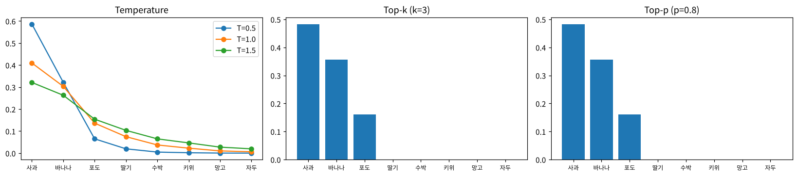

# LLM (Large Language Model, 대규모 언어 모델)

## 1. LLM의 본질
**다음 토큰 예측기**: P(xₜ | x₁…xₜ₋₁)
대규모 텍스트로 이 단순한 목표를 학습하면, 문법·지식·추론·코딩 능력이 함께 생긴다.

## 2. 토큰화 (Tokenization)
- 텍스트 → 서브워드 단위 정수 ID
- BPE, WordPiece, SentencePiece(Unigram)
- 한국어는 영어보다 같은 의미에 토큰이 더 많이 들 수 있음 → 비용·문맥 길이에 영향
- "컨텍스트 윈도우" = 한 번에 처리 가능한 토큰 수

## 3. 학습 파이프라인
```
① 사전학습 (Pre-training)
   대규모 웹/책/코드 데이터, 다음 토큰 예측 → Base model (문서 이어쓰기 능력)
② 지시 미세조정 (SFT, Supervised Fine-Tuning)
   (지시, 좋은 응답) 쌍으로 학습 → 대화·지시 따르기
③ 선호도 정렬 (Alignment)
   RLHF: 사람이 응답 순위 매김 → 보상 모델 → PPO 등 강화학습
   DPO 등: 보상 모델 없이 선호 쌍으로 직접 최적화
   RLAIF / Constitutional AI: AI 피드백 + 원칙 활용
④ (최근) 추론 강화 학습
   검증 가능한 보상(수학 정답, 코드 테스트 통과)으로 RL → 긴 사고 과정(reasoning) 능력
```

## 4. 스케일링 법칙 (Scaling Laws)
- 성능은 **파라미터 수, 데이터 양, 연산량**에 따라 예측 가능하게(멱법칙) 향상
- Chinchilla: 주어진 연산량에서 모델 크기와 데이터를 균형 있게 (대략 파라미터당 ~20 토큰)
- **추론 시 연산 스케일링(test-time compute)**: 더 오래 "생각"하게 하면 어려운 문제 성능↑

## 5. 디코딩(생성) 전략
| 방법 | 설명 |
|---|---|
| Greedy | 매번 최고 확률 토큰 |
| Beam search | 상위 k개 경로 유지 (번역 등) |
| Temperature | 분포를 날카롭게(<1)/평평하게(>1) |
| Top-k / Top-p(nucleus) | 상위 후보 내에서 샘플링 |

## 6. 파인튜닝 방법
| 방법 | 설명 | 비용 |
|---|---|---|
| Full fine-tuning | 모든 파라미터 학습 | 매우 큼 |
| **LoRA** | 가중치 변화량을 저랭크 행렬 BA로 근사, 이것만 학습 | 작음 |
| **QLoRA** | 4bit 양자화된 모델 + LoRA | 단일 GPU 가능 |
| Prefix/Prompt tuning | 학습 가능한 가상 토큰 | 매우 작음 |

언제 파인튜닝? → 먼저 **프롬프트 → RAG** 를 시도하고, 형식·스타일·도메인 행동이 꾸준히 필요할 때 파인튜닝

```python
from peft import LoraConfig, get_peft_model
from transformers import AutoModelForCausalLM
model = AutoModelForCausalLM.from_pretrained("<model-name>", torch_dtype="auto")
cfg = LoraConfig(r=16, lora_alpha=32, lora_dropout=0.05,
                 target_modules=["q_proj", "v_proj"], task_type="CAUSAL_LM")
model = get_peft_model(model, cfg)
model.print_trainable_parameters()
```

## 7. 추론 최적화 (서빙)
- **KV Cache**, Paged Attention (vLLM)
- **양자화**: FP16/BF16 → INT8/INT4 (GPTQ, AWQ, GGUF)
- Speculative decoding: 작은 모델이 초안, 큰 모델이 검증
- Continuous batching
- 증류(Distillation): 큰 모델 지식을 작은 모델로

## 8. 한계와 주의점
- **환각(Hallucination)**: 그럴듯한 거짓 → RAG, 인용, 검증으로 완화
- 지식 컷오프(학습 시점 이후 정보 모름) → 검색/도구 연결
- 프롬프트 인젝션, 탈옥 → 보안 설계 필요
- 편향, 개인정보, 저작권
- 긴 문맥에서 중간 정보 누락 ("lost in the middle")

## 9. 평가
- 지식/추론: MMLU 계열, GPQA, 수학(GSM8K, AIME 등)
- 코딩: HumanEval, SWE-bench
- 에이전트: 도구 사용·웹·OS 작업 벤치마크
- 사람 선호 평가(Arena 방식), LLM-as-a-judge
- ⚠️ 벤치마크 오염(학습 데이터 유출) 주의 → **내 과제용 평가셋**이 가장 중요

## 10. 생태계
- 폐쇄형 API 모델 vs 오픈 웨이트 모델 (Llama, Qwen, Mistral, Gemma 등 계열)
- 도구: Hugging Face transformers / datasets / peft / trl, vLLM, llama.cpp, Ollama
- 모델 순위·버전은 매우 빠르게 바뀌므로 **최신 정보는 항상 따로 확인**

## ✅ 체크리스트
- [ ] 사전학습 → SFT → 정렬(RLHF/DPO) 단계를 설명할 수 있다
- [ ] Temperature와 Top-p가 출력에 주는 영향을 안다
- [ ] LoRA의 원리(저랭크 분해)를 설명할 수 있다
- [ ] 환각의 원인과 완화책을 말할 수 있다
- [ ] 이 내용이 03_AI_Agent의 기반이 됨을 이해했다

---

## 🧪 실습

**코드** · [`dl07_llm_core_numpy.py`](code/dl07_llm_core_numpy.py) · [`dl07_lora_finetune_hf.py`](code/dl07_lora_finetune_hf.py)  
**실행 로그** · [`dl07_llm_core_numpy.txt`](code/outputs/dl07_llm_core_numpy.txt)

<p>
  
</p>

### 📝 실습 후 정리

- BPE를 직접 학습시키니 처음 보는 단어(slowest, 강화러닝)도 아는 조각으로 분해 → OOV 문제 해결 원리.
- Temperature 0.2→1.5에서 엔트로피 0.50→1.73. Top-p 0.8은 상위 3개 단어만 후보로 남김.
- LoRA(r=4)는 전체의 3.1% 파라미터로 목표 변화를 완벽히 학습. INT4 양자화 오차 19%가 그룹별 스케일로 10.7%로 감소, GQA로 KV 캐시 17.2→4.3GB.
